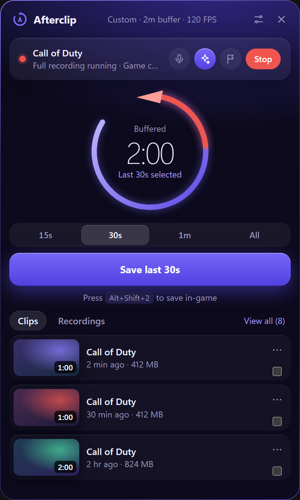

<p align="center">
  
</p>

<h1 align="center">Afterclip</h1>

<p align="center"><strong>Save the moment after it happens.</strong><br>
A lightweight game clipper for Windows, with hotkeys, Stream Deck keys and full-session recording.</p>

<p align="center">
  
  
  
</p>

<p align="center"><sub>Screenshots use sample data and placeholder thumbnails.</sub></p>

## Why Afterclip

- **It's always ready.** A rolling buffer keeps your recent gameplay in RAM, so you can save a clip after the moment happens.
- **It stays out of the way.** It lives in the tray, opens no window at startup, and uses no web view at all while the panel is closed.
- **It's small.** The installer is about 17 MB, and you don't need OBS installed. Capture runs on OBS's libobs libraries in a small windowless engine.
- **Saves are lossless.** Clips are cut from the buffer without re-encoding, so they keep their full quality.

## Features

### Clip anything, any length

Press a hotkey, click the panel or tap a Stream Deck key. Set your buffer in minutes, then save the last 15 seconds, 30 minutes, the whole buffer, or any custom length up to its size.

The ring on the panel is your buffer. Its colour shows how much has filled, and the white part, starting at the arrowhead, is what saving would keep. It turns red while recording and pulses when a clip saves. A short tone and a popup confirm each save, so you know it worked mid-game.

### Automatic game capture

Afterclip spots exclusive and borderless fullscreen games by itself and hooks them directly. Until the hook connects, or if it fails, it records that game's monitor so you still have footage. Without a game, it records your primary monitor.

### Full-session recording

Record whole sessions while the clip buffer keeps running, with no extra encode. Long recordings can split into a new file on a timer, and markers become chapters in the file.

<p align="center">
  
  
  
</p>

### Audio that stays separate

- **Game audio** follows the game to whichever device or mixer channel it plays through, including Voicemeeter and SleekMeeter.
- **Any source** can be an output, an input, or a single app such as Discord.
- **Separate tracks:** put each source in the main mix, on its own track (up to 5), or both. Own tracks survive trimming and merging.
- **Live control:** every source has a volume slider up to 200% that applies straight away, plus a level meter.
- **Clean Mic** removes background noise and keyboard sound with one click.
- **Mic mute** silences your mic in clips and recordings only, so calls aren't affected.

### Share by dragging

Drag a clip straight into Discord or any other app, the same way you would from File Explorer. Or choose **Copy file** from its menu and paste it.

### A lossless editor

Trim with drag handles, reorder clips, and merge them into one video. Nothing is re-encoded, your originals are never changed, and separate audio tracks are kept.

<p align="center">
  
</p>

### Stream Deck keys

Keys for 15 and 30 seconds, for 1 to 30 minutes, **Save Full Buffer**, **Record**, **Mute Mic In Clips**, and **Save Custom Length**. They show live state, including when recording or when Afterclip isn't running.

<p align="center">
  
</p>

### Quality your way

Choose Low, Medium, High or Full quality, or set each option yourself: resolution up to native, 60 fps, 120 fps or your monitor's rate, and H.264, HEVC or AV1. Works with NVIDIA, AMD and Intel GPUs, or the CPU. If an encoder can't start, Afterclip falls back to one that can, and shows which it's using. The Performance section shows frame rate, lost frames, CPU, memory and free disk space.

## Install

There's no published release yet, so build it from source for now.

You need Node, Rust, and Visual Studio with the C++ tools.

```bash
npm install
```

```bash
npm run dist
```

The installer is written to `src-tauri/target/release/bundle/nsis/`. It installs to `Program Files`, and Windows asks for permission once.

To run from source instead:

```bash
npm start
```

### Install the Stream Deck plugin

Double-click `streamdeck\dist\com.afterclip.clips.streamDeckPlugin`, which `npm run dist` creates. To rebuild only the plugin, run `npm run plugin`.

## Using it

Click the tray icon to open the panel. It closes when you click away, and frees its memory 20 seconds later. Clips and recordings save to `Videos\Afterclip`, and you can change the folder in Settings.

### Default hotkeys

| Keys | Action |
| --- | --- |
| `Alt+Shift+1` | Clip last 15s |
| `Alt+Shift+2` | Clip last 30s |
| `Alt+Shift+3` | Clip last 60s |
| `Alt+Shift+4` | Clip whole buffer |
| `Alt+Shift+R` | Start or stop recording |
| `Alt+Shift+M` | Mute or unmute your mic in clips |
| `Alt+Shift+K` | Add a marker to a recording |

You can change these and add more clip lengths in Settings.

### Good to know

- **Run as administrator:** some games, such as Call of Duty, need this for game capture. Turn it on in General. Windows asks once, then Afterclip starts without a prompt through a scheduled task. Turning it off removes the task the next time Afterclip runs elevated, and uninstalling always does.
- **Buffer size:** the buffer lives in RAM, so a longer one or a higher bitrate uses more memory. Settings shows an estimate.
- **Changing settings:** buffer, audio and video changes restart capture, which clears the buffer. Volume changes don't.
- **Trim accuracy:** keyframes are 1 second apart, so a clip or trim can start up to about 1 second early, but never late. Only clips with matching video settings can merge.
- **Mic mute timing:** it applies from the moment you press it, so anything already in the buffer keeps your mic.
- **Doubled game audio:** Afterclip avoids this when the main mix already records the game's device. It can't see inside a mixer's routing, so if you record a mixer output that also carries the game, turn **Record the game's audio** off.
- **Not detected:** windowed games aren't detected, so they're only recorded if they're on your primary monitor. Fullscreen browsers and video players count as normal desktop use.
- **HEVC and AV1:** these give smaller files, but not every app can play them, and the editor's preview may not.

## How it works

Afterclip has three parts of its own, and never starts the OBS app:

- **`afterclip.exe`:** the app, written in Rust with Tauri. Its windows use Windows' built-in WebView2.
- **`afterclip-engine.exe`:** a windowless capture program built on libobs.
- **`afterclip-media.exe`:** a small helper that trims clips and makes thumbnails, one job per process.

Some details:

- **Engine link:** the app talks to the engine over private pipes. If the app dies for any reason, the pipes close, and the engine finalizes any recording and exits.
- **Clip lengths:** each clip saves the whole rolling buffer, then the media helper losslessly cuts the last N seconds.
- **Network:** the engine listens on no ports. OBS's game capture plugin connects out to `obsproject.com` to update its game compatibility list. The Stream Deck plugin uses a token-protected API on `127.0.0.1:4467`.
- **Security:** a silently elevated task must not point at a folder anything can rewrite, so it's only created for a copy in `Program Files`. An elevated copy also ignores test settings and WebView2 override variables.

`npm run build:engine` downloads the official OBS release and its FFmpeg headers, verifies their checksums, compiles the engine and media helper, and assembles `vendor/engine` with only the files they need (about 56 MB). To change version, edit `OBS_VERSION` in `scripts/fetch-obs.js` and `DEPS_VERSION` in `scripts/build-engine.js`.

## Tests

Build first with `npm run dist`, and run these from a normal, non-administrator terminal.

These two are safe to run during a game:

```bash
npm run test:plugin
```

```bash
npm run test:media
```

The others hook fullscreen apps, take focus, move the mouse or press keys, and refuse to run while a fullscreen app is in the foreground. **Close your game first.**

Drives the real app on a colour card, so nothing from your screen or microphone is captured:

```bash
npm run test:e2e
```

Records your real desktop to a temp folder, measures only colour, and deletes the clips. It also opens a fullscreen magenta window for about 20 seconds:

```bash
npm run test:capture
```

Drives the real panel and editor with the real mouse and clipboard, and reads pixels off the screen to catch blank windows. It briefly captures desktop audio and one running app, only to count tracks, then deletes the clips. It restores clipboard text afterwards, but not images:

```bash
npm run test:ui
```

Set `AFTERCLIP_APP_EXE` to test a specific `afterclip.exe`.

## Licences

See [THIRD_PARTY.md](THIRD_PARTY.md). The engine and media helper link to GPL code, which adds obligations when you distribute Afterclip.
