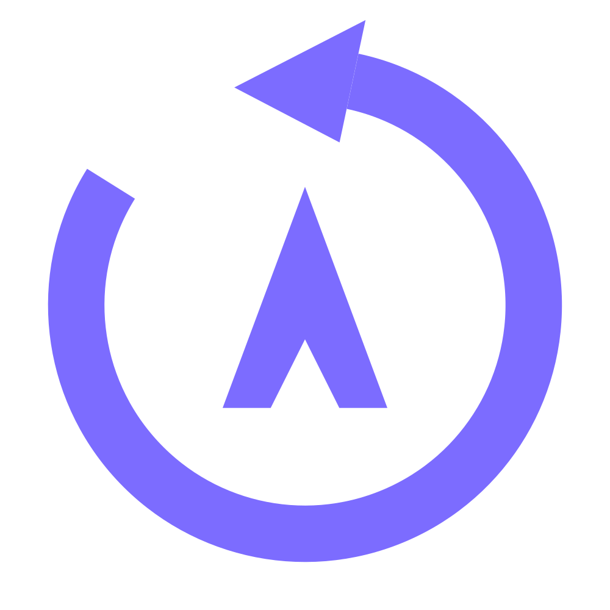
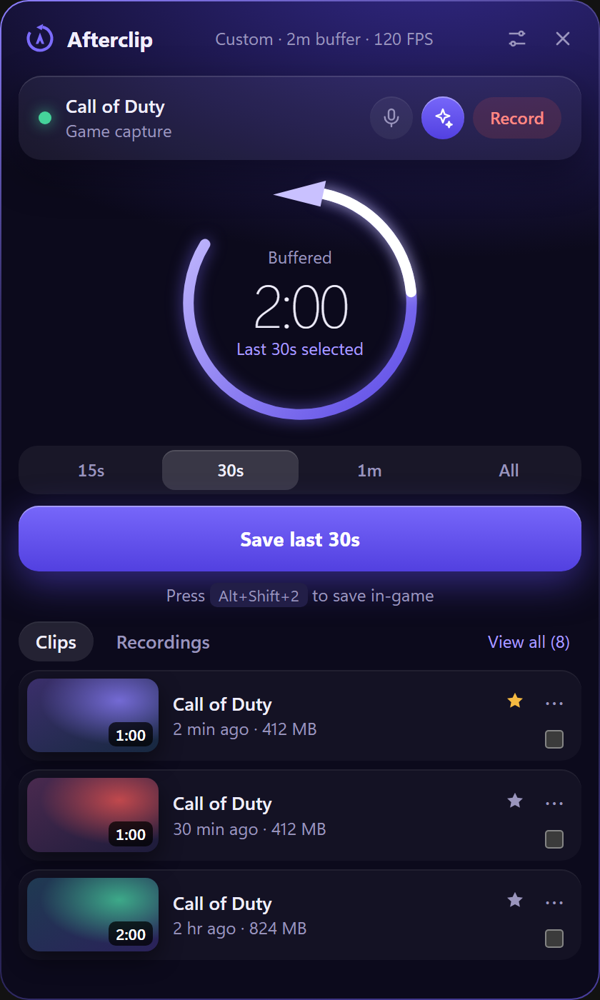
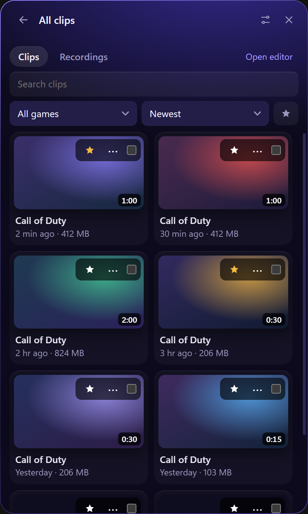
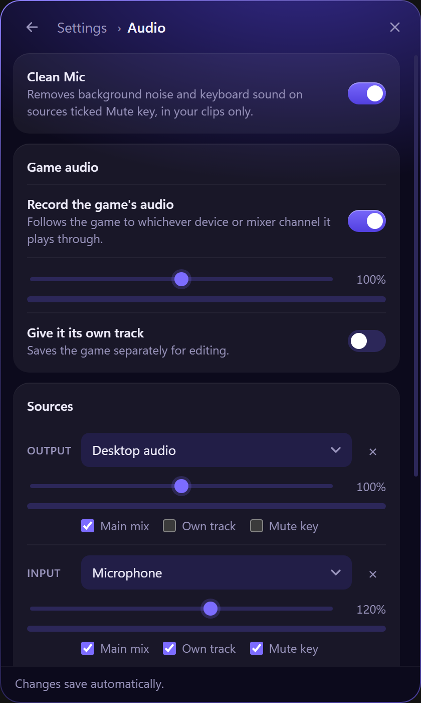
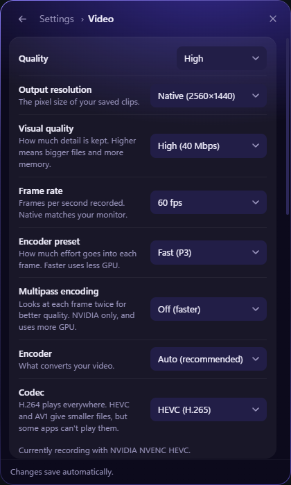
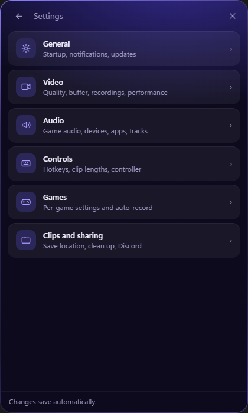
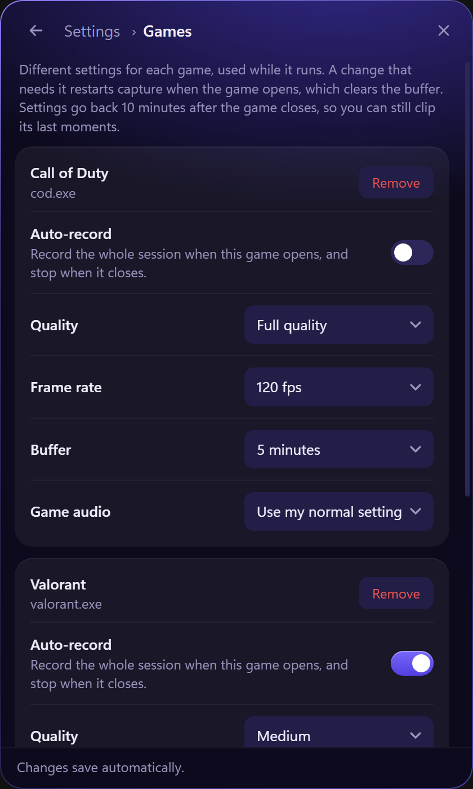
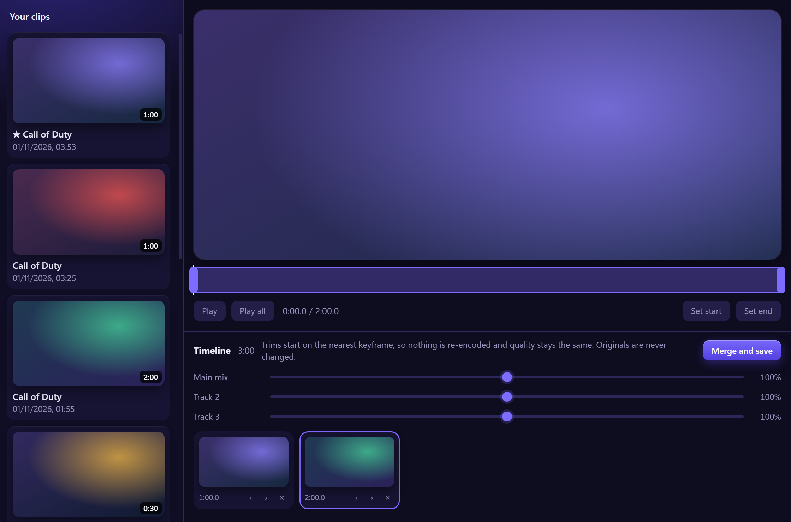
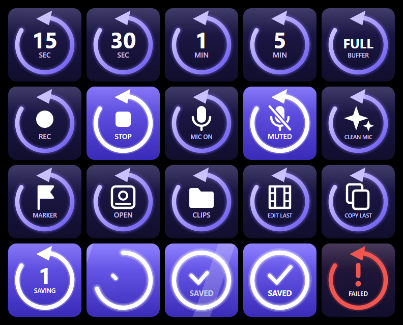

<p align="center">
  
</p>

<h1 align="center">Afterclip</h1>

<p align="center"><strong>Save the moment after it happens.</strong><br>
A lightweight game clipper for Windows, with hotkeys, Stream Deck keys and full-session recording.</p>

<p align="center"><a href="https://afterclip.app"><strong>afterclip.app</strong></a></p>

<p align="center">
  
  
  
</p>

<p align="center"><sub>The library, audio and games screenshots use sample data and placeholder thumbnails.</sub></p>

## Why Afterclip

- **It's always ready.** A rolling buffer keeps your recent gameplay in RAM, so you can save a clip after the moment happens.
- **It stays out of the way.** It lives in the tray, opens no window at startup, and frees the panel's memory 20 seconds after you close it.
- **Capture runs in a small windowless engine.** The installer includes the capture libraries and offline editing tools.
- **Saves are lossless.** Clips are cut from the buffer without re-encoding, so they keep their full quality.

## Features

### Clip anything, any length

Press a hotkey, click the panel or tap a Stream Deck key. Set your buffer in minutes, then save the last 15 seconds, 30 minutes, the whole buffer, or any custom length up to its size. **Keep recording after you save** can wait a few seconds before saving, so what happens just after you press is in the clip too.

The glass card at the top of the panel shows your buffer. The timer shows how much has filled, and in the thin line along its bottom edge, the white part is what saving would keep. That part turns red while recording, the glass shines when a clip saves, and the card warns you if frames are being lost. A short tone and a popup confirm each save, so you know it worked mid-game.

### Automatic game capture

Afterclip spots exclusive and borderless fullscreen games by itself and hooks them directly. A game you add under **Settings > Games** is captured even when it plays in a window. Until the hook connects, or if it fails, it records that game's monitor so you still have footage. Without a game, it records your primary monitor, or with **Only buffer during games** on, it stops the buffer until a game opens, to free memory and GPU on the desktop.

### Vertical mode

Turn on **Vertical mode** in **Settings > Video**, or for one game in **Settings > Games**, to capture in 9:16 for phones. Clips, recordings and screenshots then save vertical, straight away and without re-encoding. The picture is the middle of the game at your resolution's height, such as 810×1440 on a 1440p monitor. With your webcam on, it goes across the top and the game fills the space below. While it's on, the sides of the game aren't captured, and switching it on or off restarts capture, which clears the buffer.

### Your webcam

**Settings > Video** can put your webcam in any corner of every clip and recording, at three sizes. A vertical copy of a clip with your webcam puts it above the game, ready for TikTok or Shorts.

### Full-session recording

Record whole sessions while the clip buffer keeps running, with no extra encode. Long recordings can split into a new file on a timer, and markers become chapters in the file.

<p align="center">
  
  
</p>

### Audio that stays separate

- **Game audio** follows the game to whichever device or mixer channel it plays through, including Voicemeeter and SleekMeeter.
- **Any source** can be an output, an input, or a single app such as Discord.
- **Separate tracks:** put each source in the main mix, on its own track (up to 5), or both. Own tracks survive trimming and merging.
- **Live control:** every source has a volume slider up to 200% that applies straight away, plus a level meter.
- **Clean Mic** removes background noise and keyboard sound with one click.
- **Mic mute** silences your mic in clips and recordings only, so calls aren't affected.
- **Push to talk** only puts your mic in clips while you hold a key or a mouse side button. Your game still gets the press.

### Share anywhere

Drag a clip straight into Discord or any other app, the same way you would from File Explorer. Or choose **Copy file** from its menu and paste it.

From a clip's menu you can also make a **vertical copy** for phones, which keeps the middle of the picture at 9:16, or use **Send to Discord**. Add named channels under **Settings > Clips and sharing**, then pick where to send each clip. A clip over Discord's 10 MB limit is sent as a smaller copy. **Trim and share** lets you pick a range and choose recorded audio tracks from the clip menu. **Even out volume** levels the audio in share copies.

**Screenshots** are saved as PNGs by a hotkey, a controller combination, a Stream Deck key or the camera button. **Settings > Clips and sharing** can move anything older than a set age to the Recycle Bin, leaving your favourites alone.

Clips this good are big, so **Compress** re-encodes a smaller H.264 copy, using your GPU where it can, with the main audio mix. It aims for 100 MB at up to 1080p and 60 FPS. A clip too long to look good at that size (over about 3 minutes) keeps its 1080p60 and goes over, and Afterclip tells you the size it reached. Your original stays as it is.

### A library that stays tidy

**View all** shows every clip and recording, with search, a game filter and sorting. Star your favourites, rename clips to something you'll recognise, and tag them, such as #funny, to find them by tag later. Move the mouse across a video's thumbnail to scrub through it without opening it. Afterclip can also save into a folder for each game. A **storage limit** keeps things under control: above it, your oldest clips go to the Recycle Bin, and favourites are never touched. When your drive runs low, Afterclip warns you, and a recording stops safely before the drive fills.

### Settings for each game

Give any game its own quality, frame rate, buffer length and game audio setting, used while it runs. **Auto-record** starts a full recording when a game opens and stops it when it closes.

<p align="center">
  
</p>

### A lossless editor

Trim with drag handles, reorder clips, and merge them into one video. Nothing is re-encoded, your originals are never changed, and separate audio tracks are kept. Turn any track up, down or off before saving, and only that track is re-encoded.

### Automatic updates

Afterclip downloads new versions by itself and shows a countdown before installing, so you can **Skip this version**. It waits while you're in a game or recording, and refuses any update that isn't signed.

<p align="center">
  
</p>

### Stream Deck keys

Keys for 15 and 30 seconds, for 1 to 30 minutes, **Save Full Buffer**, **Save Custom Length**, **Record**, **Mute Mic In Clips**, **Clean Mic**, **Add Marker**, **Take Screenshot**, **Open Afterclip**, **Open Clips Folder**, **Edit Last Clip**, **Copy Last Clip**, **Compress Last Clip**, **Send Last Clip to Discord**, **Vertical Copy of Last Clip**, **Star Last Clip**, **Save and Star**, **Show Your Webcam** and **Hold to Talk**, which puts your mic in clips while you hold it, with Push to talk on.
 They show live state, including when recording or when Afterclip isn't running, and a saved clip closes the key's ring into a lit circle.

On a Stream Deck +, the **Mic Volume** dial turns your mic up or down in clips, and pressing it mutes your mic in clips. The **Clip Length Dial** picks a length as you turn it, saves that length when you press it, and shows how full your buffer is.

<p align="center">
  
</p>

### Quality your way

Choose Low, Medium, High or Full quality, or set each option yourself: resolution up to native, 60 fps, 120 fps or your monitor's rate, and H.264, HEVC or AV1. Works with NVIDIA, AMD and Intel GPUs, or the CPU. If an encoder can't start, Afterclip falls back to one that can, and shows which it's using. The Performance card under **Settings > Video** shows frame rate, lost frames, CPU, memory and free disk space.

## Install

Download the installer from [afterclip.app](https://afterclip.app) or the [latest release](https://github.com/minimalhandle/Afterclip/releases/latest) and run it. It installs to `Program Files`, and Windows asks for permission once. The installer isn't code-signed yet, so Windows may show a SmartScreen warning: choose **More info**, then **Run anyway**.

For Stream Deck keys, download the `.streamDeckPlugin` file from the same release and double-click it.

**Two PCs:** the Stream Deck can control Afterclip on another PC, such as your gaming PC from your streaming PC. On the PC that runs Afterclip, turn on **Allow a Stream Deck on another PC** in **Settings > Controls**, and copy the address it shows. On the PC with the Stream Deck, install the plugin, open any Afterclip key's settings, paste the address into **Address**, and press **Connect**. All the keys then control that PC. Install Afterclip on the PC that runs the game, because it records the game where it runs, not from a capture card.

### Build from source

You need Node, Rust, and Visual Studio with the C++ tools.

```bash
npm install
```

```bash
npm run dist
```

The installer is written to `src-tauri/target/release/bundle/nsis/`.

To run from source instead:

```bash
npm start
```

To package the Stream Deck plugin yourself, run this, then double-click `streamdeck\dist\com.afterclip.clips.streamDeckPlugin`:

```bash
npm run plugin
```

## Using it

Click the tray icon to open the panel. It closes when you click away, and frees its memory 20 seconds later. Clips, recordings and screenshots save to `Videos\Afterclip`, and you can change the folder in Settings.

### Default hotkeys

| Keys | Action |
| --- | --- |
| `Alt+Shift+1` | Clip last 15s |
| `Alt+Shift+2` | Clip last 30s |
| `Alt+Shift+3` | Clip last 60s |
| `Alt+Shift+4` | Clip whole buffer |
| `Alt+Shift+R` | Start or stop recording |
| `Alt+Shift+M` | Mute or unmute your mic in clips |
| `Alt+Shift+K` | Add a marker to a recording |
| `Alt+Shift+S` | Take a screenshot |

You can change these and add more clip lengths in Settings.

### Good to know

- **Run as administrator:** some games, such as Call of Duty, need this for game capture. Turn it on in General. Windows asks once, then Afterclip starts without a prompt through a scheduled task. Turning it off removes the task the next time Afterclip runs elevated, and uninstalling always does.
- **Buffer size:** the buffer lives in RAM, so a longer one or a higher bitrate uses more memory. Settings shows an estimate.
- **Changing settings:** buffer, audio and video changes restart capture, which clears the buffer. Volume changes don't.
- **Trim accuracy:** keyframes are 1 second apart, so a clip or trim can start up to about 1 second early, but never late. Only clips with matching video settings can merge.
- **Mic mute timing:** it applies from the moment you press it, so anything already in the buffer keeps your mic.
- **Push to talk:** it affects the sources ticked **Mute key**, and the mute key still wins. Afterclip reads whether the key is held without taking the press, so the game and Discord still get it. It hasn't been tried yet in a game that runs as administrator.
- **Webcam:** its light stays on while it's shown and Afterclip is buffering, because the webcam is part of the buffer. Switching it off lets go of the webcam, and switching it on or off doesn't restart capture. Choosing a different webcam, corner or size does. Only its picture is used, never its microphone.
- **Only buffer during games:** the buffer stops 10 minutes after the game closes, so you can still clip its last moments. Record works at any time, and starts the buffer if needed. A windowed game you haven't added under **Settings > Games** doesn't count as a game.
- **Game folders:** only new files go into them. A folder is removed once it's empty.
- **Stream Deck on another PC:** keys act on the PC running Afterclip, so Copy Last Clip, Open Clips Folder, Open Afterclip and Edit Last Clip copy and open things there. The first time it's turned on, Windows Firewall may ask whether Afterclip can use your network: allow it on private networks. Importing settings never turns this on.
- **Moving to another PC:**
 **Export settings** in General saves your settings, hotkeys and game profiles to a file, and **Import settings** loads them. Your Discord webhook is never in the file, and a save location on a drive the PC doesn't have is left as it is.
- **Doubled game audio:** Afterclip avoids this when the main mix already records the game's device. It can't see inside a mixer's routing, so if you record a mixer output that also carries the game, turn **Record the game's audio** off.
- **Not detected:** a windowed game you haven't added under **Settings > Games** isn't detected, so it's only recorded if it's on your primary monitor. Fullscreen browsers and video players count as normal desktop use.
- **Controllers:** turn this on in Settings, Controls. Hold Create, View or −, then press R3 to save a clip. Other actions can be added there. Afterclip only listens, and never sends anything to the controller, so your game also receives these presses. Tested on a DualSense over USB and Bluetooth. Xbox and Switch Pro support hasn't been tried on real controllers yet. Switch Pro needs Bluetooth, unless Steam is running.
- **Adding a game:** open the game, then choose it in Settings, Games. Afterclip lists what's open, with likely games first, and only looks at the list, so it never touches the game. Some games hidden by anti-cheat may not be listed, so use Browse to find their program file.
- **Game profiles:** a profile that changes capture settings restarts capture when the game opens, which clears the buffer. Normal settings return 10 minutes after the game closes, so you can still clip its last moments. Neither happens during a recording.
- **Long clips:** Compress keeps a long clip at 1080p60 and lets it go over 100 MB. Send to Discord can't, so it asks you to trim a clip too long to fit.
- **Track volumes:** a source in the main mix can't be taken back out of it. To remove something like Discord later, record it on its own track and out of the main mix.
- **If capture stops by itself:** an encoder error, a crash or a graphics driver update can stop capture. Afterclip starts it again by itself, waiting a little longer each time, for about seven minutes, which covers a driver install. Whatever was in the buffer is lost, and the panel says when capture is back. If capture had to fall back to the CPU encoder while the driver was being replaced, it tries your graphics card again every minute, but never during a recording.
- **Updates:** installing by itself needs Run as administrator, because otherwise Windows would show a UAC prompt out of nowhere. Without it, updates wait for you to click **Update now**. Turn **Automatic updates** off in General to stop Afterclip checking GitHub.
- **Reporting a problem:** in General, **Save diagnostics** saves your logs and settings in one zip file to attach to a GitHub issue. Your Discord webhook and Windows user folder are left out, and nothing is sent anywhere. The logs do show your hardware, monitors, audio devices and game names.
- **HEVC and AV1:** these give smaller files, but not every app can play them, and the editor's preview may not.

## How it works

Afterclip has three parts of its own, and never starts the OBS app:

- **`afterclip.exe`:** the app, written in Rust with Tauri. Its windows use Windows' built-in WebView2.
- **`afterclip-engine.exe`:** a windowless capture program built on libobs.
- **`afterclip-media.exe`:** a small helper that trims and compresses clips, and makes thumbnails, previews and screenshots, one job per process.

Some details:

- **Engine link:** the app talks to the engine over private pipes. If the app dies for any reason, the pipes close, and the engine finalizes any recording and exits.
- **Clip lengths:** each clip saves the whole rolling buffer, then the media helper losslessly cuts the last N seconds.
- **Network:** the engine listens on no ports. OBS's game capture plugin connects out to `obsproject.com` to update its game compatibility list. Automatic updates check this repository's latest release on GitHub. **Send to Discord** only connects when you use it, and only to Discord's own addresses. The Stream Deck plugin uses a token-protected API on `127.0.0.1:4467`. With **Allow a Stream Deck on another PC** on, it also listens on your local network on port 4468, or one you choose, and every request must carry the key from the address. A wrong key is answered slowly, so guessing it is impractical. The connection isn't encrypted, so use it on your own network, not on shared Wi-Fi. **New key** in Settings stops an old address working.
- **Library data:** favourites, tags, where a clip's webcam sat, and which game a renamed clip came from, are kept in `%LOCALAPPDATA%\Afterclip\library.json`. Clips stay ordinary files.
- **Where things live:** the app is in `C:\Program Files\Afterclip`, and your clips, recordings and screenshots are in your save folder, with a hidden `.staging` folder beside them for files being written. Everything else, including settings, thumbnails, previews and logs, is in `%LOCALAPPDATA%\Afterclip`.
- **Security:** a silently elevated task must not point at a folder anything can rewrite, so it's only created for a copy in `Program Files`. An elevated copy also ignores test settings and WebView2 override variables.

`npm run build:engine` downloads the official OBS release and its FFmpeg headers, verifies their checksums, compiles the engine and media helper, and assembles `vendor/engine` with only the files they need (about 57 MB).
 To change version, edit `OBS_VERSION` in `scripts/fetch-obs.js` and `DEPS_VERSION` in `scripts/build-engine.js`.

## Tests

Build first with `npm run dist`, and run these from a normal, non-administrator terminal.

These two are safe to run during a game:

```bash
npm run test:plugin
```

```bash
npm run test:media
```

The others hook fullscreen apps, take focus, move the mouse or press keys, and refuse to run while a fullscreen app is in the foreground. **Close your game first.**

Drives the real app on a colour card, so nothing from your screen or microphone is captured:

```bash
npm run test:e2e
```

Records your real desktop to a temp folder, measures only colour, and deletes the clips. It also opens a fullscreen magenta window for about 20 seconds:

```bash
npm run test:capture
```

Drives the real panel and editor with the real mouse and clipboard, and reads pixels off the screen to catch blank windows. It briefly captures desktop audio and one running app, only to count tracks, then deletes the clips. It restores clipboard text afterwards, but not images:

```bash
npm run test:ui
```

Normal builds only accept updates over HTTPS, so the updater checks need a special build. Never ship this one. Run these one at a time, then rebuild normally:

```bash
npx tauri build --no-bundle --config src-tauri/tauri.updater-test.conf.json
```

```powershell
$env:AFTERCLIP_TEST_UPDATER = '1'; npm run test:ui
```

Set `AFTERCLIP_APP_EXE` to test a specific `afterclip.exe`.

## Releasing

`npm run release` builds the installer and signs it, and writes the `latest.json` that existing copies read. Upload the installer, its `.sig` and `latest.json` to the GitHub release. It needs the private signing key at `%USERPROFILE%\.afterclip\updater.key`. Keep a backup of that key somewhere safe and never commit it: without it, existing copies won't accept any future update.

## Licence

Afterclip is free software, licensed under the [GNU General Public License, version 2 or any later version](LICENSE) (GPL-2.0-or-later). It comes with no warranty. If you distribute it or a modified version, you must also offer the source code under the same terms.

It's built on OBS Studio, FFmpeg and other open-source projects. See [THIRD_PARTY.md](THIRD_PARTY.md).
